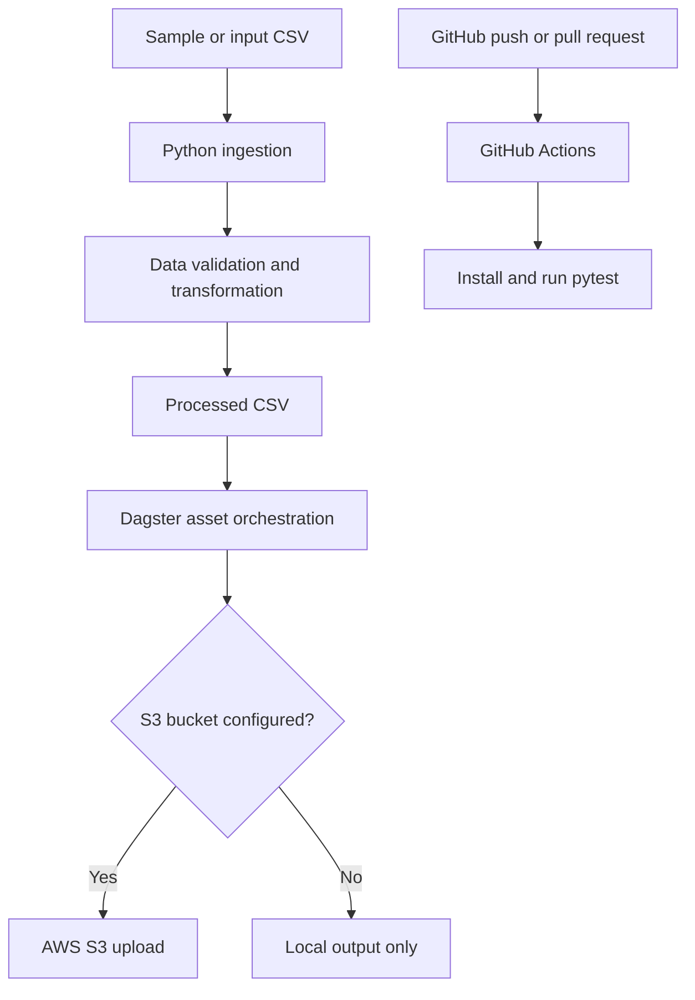

# Cloud Engineering and Orchestration Project

A portfolio project demonstrating a cloud-ready data workflow using **AWS S3, Python, Dagster, GitHub Actions and CI/CD**.

The workflow generates or accepts a CSV dataset, validates and transforms it, stores the processed output locally, and can upload the result to an AWS S3 bucket. Dagster orchestrates the assets. GitHub Actions installs dependencies and runs automated tests on pushes and pull requests.

> **Important:** This repository provides an AWS S3 integration and deployment instructions. It does not include AWS credentials or claim that resources have already been deployed to an AWS account. The pipeline runs locally without AWS; configure an S3 bucket and credentials to perform a real cloud upload.

## Architecture



## Technology stack

- Python and pandas — ingestion, validation and transformation
- AWS S3 and boto3 — object storage integration
- Dagster — asset-based workflow orchestration
- GitHub Actions — automated CI checks
- pytest — unit tests

## Project structure

- `src/cloud_pipeline/` — application code and Dagster definitions
- `config/pipeline.yaml` — configurable pipeline settings
- `tests/` — unit tests
- `.github/workflows/ci.yml` — CI workflow
- `docs/aws-setup.md` — AWS setup and deployment guide

## Run locally

Requires Python 3.10 or newer.

```bash
cd cloud-engineering-orchestration
python -m venv .venv
source .venv/bin/activate        # Windows: .venv\Scripts\activate
pip install -r requirements.txt
pip install -e .
python -m cloud_pipeline.pipeline
pytest -q
```

The default run creates `data/raw/energy_sample.csv` and `data/processed/energy_processed.csv`.

## Launch Dagster

```bash
dagster dev -m cloud_pipeline.definitions
```

Open the Dagster UI at the local address printed in the terminal and materialise the `cloud_data_pipeline` job. The assets run in dependency order: `source_data` → `processed_data` → `s3_upload`.

## Configure AWS S3 upload

1. Create an S3 bucket in your AWS account.
2. Create an IAM identity with only the required permissions for the target bucket/prefix (see `docs/aws-setup.md`).
3. Configure AWS credentials securely using an AWS profile or environment variables.
4. Set the bucket and object prefix:

```bash
export AWS_S3_BUCKET="your-bucket-name"
export AWS_S3_PREFIX="portfolio/energy"
```

5. Run the Dagster job. When `AWS_S3_BUCKET` is configured, the final asset uploads the processed CSV to S3. Without a bucket setting, it reports that the upload was skipped and keeps the local output.

Never commit AWS access keys, secret keys, session tokens, or account credentials.

## GitHub Actions CI/CD

The workflow in `.github/workflows/ci.yml` runs on pushes and pull requests. It installs the project and runs pytest. This is a CI validation workflow; it does not deploy AWS infrastructure or upload to S3 automatically.

## Evidence to add after running

Capture your own screenshots of:
1. Successful local pipeline execution
2. Passing pytest output
3. Dagster asset materialisation
4. The processed object visible in your S3 bucket (only after configuring AWS)

Do not describe the AWS upload or cloud deployment as completed until you have run it in your own AWS account.
